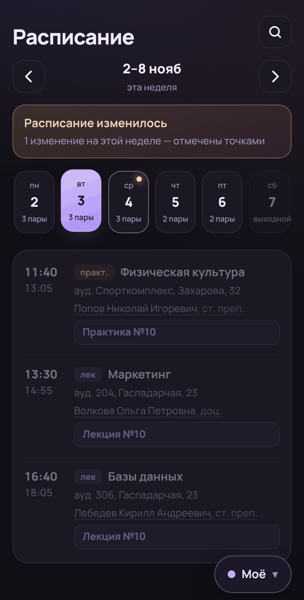
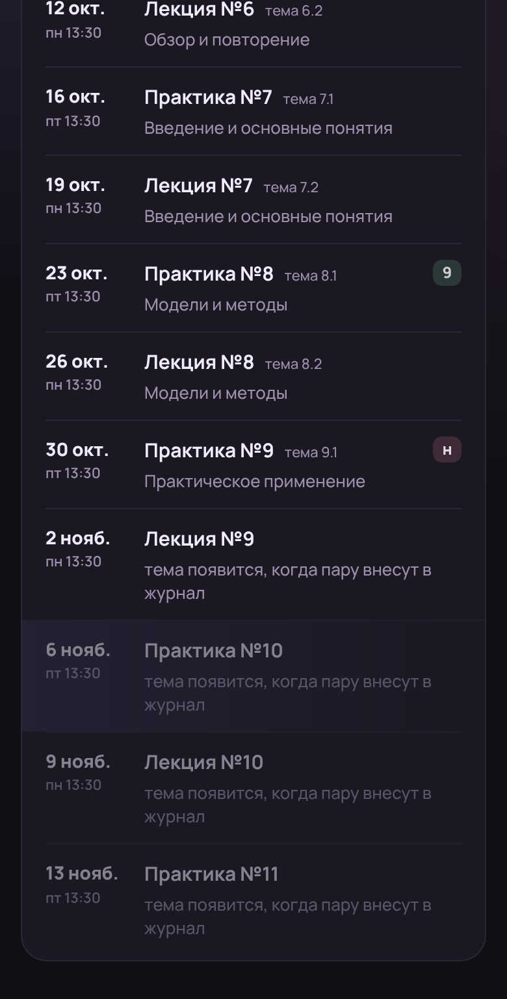
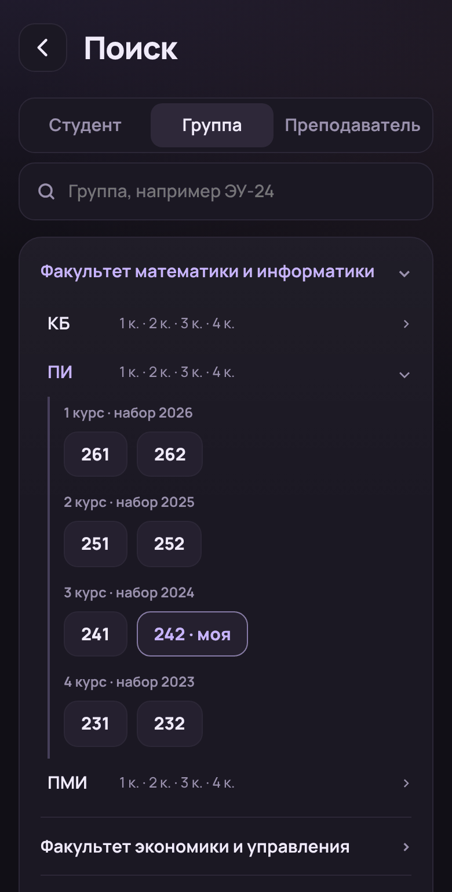
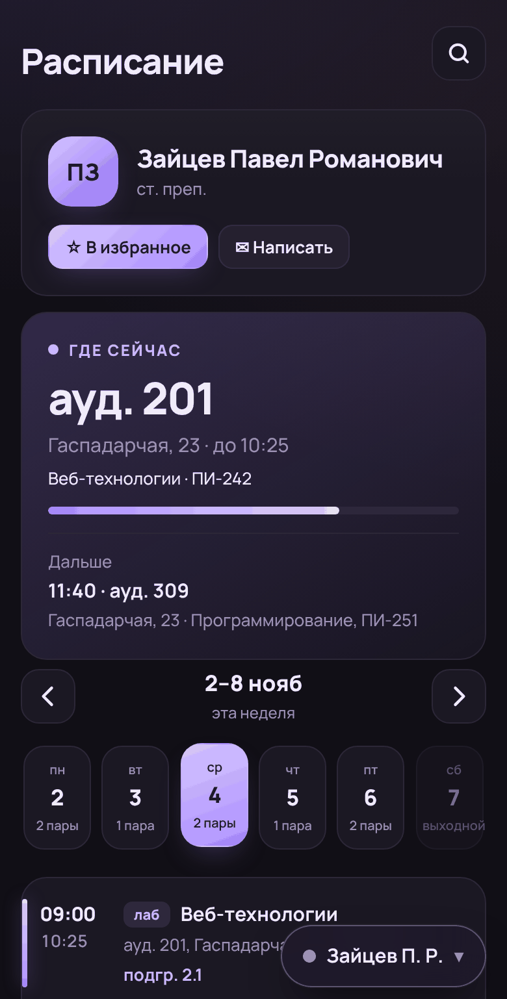
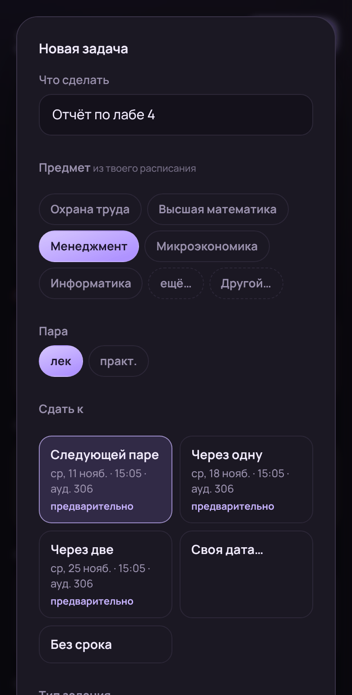

# UniTrack

Приложение для студентов ГрГУ им. Янки Купалы: личное расписание, задачи «к паре» и данные из личного кабинета в одном месте. Windows и Android.

<p>
  
  
  
  
  
</p>

<sub>Скриншоты из демо-режима: все люди, группы и оценки выдуманы.</sub>

> **Неофициальное приложение.** К ГрГУ и его IT-службам отношения не имеет. Данные берутся из открытого API расписания ГрГУ и из личного кабинета под логином самого студента. Приложение только читает, на сайте ничего не меняет.

## Зачем

Официальные сервисы показывают расписание, но не отвечают на вопросы, которые возникают каждый день: какая это по счёту практика и какая у неё тема, что изменилось в расписании, где сейчас преподаватель, когда мы с другом оба освободимся. UniTrack собирает это в одном месте и работает без интернета на том, что уже загрузил.

## Возможности

**Расписание**
- Личное расписание с подгруппами, по неделям, с первой недели семестра.
- Номер и тема каждой пары из журнала («Практика №8 · Модели и методы»). Номера ближайших пар, которых ещё нет в журнале, досчитываются по расписанию.
- Изменения в расписании: перенос, смена аудитории и отмена подсвечиваются на месте.
- Прогноз следующей недели, пока её не выложили (с пометкой «предварительно»).
- Полупары и перерыв в карточке текущей пары.

**Поиск**
- Студент по логину, группы по факультетам и специальностям, преподаватели по ФИО.
- Избранное с синхронизацией между устройствами.
- «Где сейчас» преподаватель: аудитория, до скольки пара, куда дальше.
- «Когда освобождаетесь»: по дням, кто во сколько заканчивает и с какого времени свободны оба.

**Задачи**
- Срок задаётся парой, а не датой: «к следующей лабе», «через одну».
- Если пару перенесли, срок задачи сдвигается сам, с отметкой об этом.
- Синхронизация ноутбук ↔ телефон по домашнему Wi-Fi, без облака.

**Личный кабинет:** курсы, успеваемость, зачётка, рейтинг, библиотека со сроками возврата, посещаемость.

**Оформление:** 13 тем (тёмные, светлые, «как в системе») и 14 стилей карточек — от стекла и неона до тетради и стикеров. 11 иконок приложения на выбор.

**Обновления:** приложение само находит новую версию в Releases и ставит её.

## Как это сделано

Проект сделан с помощью ИИ (Claude): код почти целиком сгенерирован. Моя часть:

- **Продукт.** Придумал, что и зачем делать, и решал, что оставить: задачи «к паре» вместо даты, переключатель расписаний под большой палец, фокус «Когда освобождаетесь» на конце дня.
- **Исследование API.** Нашёл в DevTools браузера, какими запросами личный кабинет получает журнал занятий и список предметов, с какими параметрами, и проверял их вручную.
- **Процесс.** Каждая версия шла по циклу: список изменений → моё подтверждение → реализация → скриншоты → проверка на реальных устройствах → релиз. Ни одно изменение не попадало в репозиторий без моего ревью.
- **Безопасность и приватность.** Сформулировал требования: пароль никуда, кроме портала вуза; синхронизация только в локальной сети; в демо-данных ни одного реального человека.
- **Релизы.** Версии, теги, проверка сборок и обновлений.

## Устройство

| Часть | Что использовано |
|---|---|
| Приложение | Tauri 2: Rust-бэкенд и интерфейс на чистых HTML/CSS/JS, без фреймворков |
| Вход | Прохождение единого входа (SAML) портала, одна сессия на все запросы, автоматический повторный вход |
| Данные | Открытый API расписания ГрГУ и API личного кабинета, только чтение. Всё кэшируется на устройстве |
| Синхронизация | Локальный HTTP-сервер на ноутбуке, поиск по UDP в Wi-Fi сети, код из 6 цифр, слияние по времени изменения |
| Тесты | Rust (`cargo test`) и Node (`node --test`): вход, синхронизация, разбор расписания, изменения, сроки задач, номера пар |
| CI/CD | GitHub Actions: установщик Windows и подписанный APK для Android по тегу; сборка не опубликует релиз, если тег не совпадает с версией |

## Безопасность

- Логин и пароль хранятся только на устройстве (Windows Credential Manager / закрытая папка приложения на Android) и отправляются только на `edu.grsu.by` и `idp.grsu.by`.
- Своих серверов и телеметрии нет.
- Синхронизация принимает только устройства из локальной сети с правильным кодом; после 5 ошибок блокируется на минуту. Внутри сети данные идут без шифрования, поэтому в чужом публичном Wi-Fi синхронизироваться не стоит.
- Обновления скачиваются только из Releases этого репозитория; Android дополнительно проверяет подпись.
- Строгий CSP в окне приложения; документы с сайта показываются в изолированном фрейме.

## Установка

Последняя версия — в [Releases](../../releases/latest): `UniTrack-x.y.z-setup.exe` для Windows, `UniTrack-x.y.z.apk` для Android.

## Сборка

Нужны Rust, Node.js 20+ и (для Windows) Visual Studio Build Tools.

```
npm install
npm run dev     # запуск
npm test        # тесты
npm run build   # установщик
```

Демо-режим без входа: открыть `src/index.html` через любой локальный сервер.

## Лицензия

MIT.

---

**In English.** UniTrack is an unofficial companion app for Grodno State University students (Windows + Android, Tauri 2 / Rust / vanilla JS). Personal timetable with lesson numbers and topics from the course journal, timetable change detection, search for students, groups and teachers, "when are we both free" for friends, lesson-based task deadlines that follow rescheduled classes, and offline LAN sync between laptop and phone. Built with AI assistance (Claude): I defined the product, reverse-engineered the portal's API in DevTools, reviewed every change, tested on devices and ran the releases.
